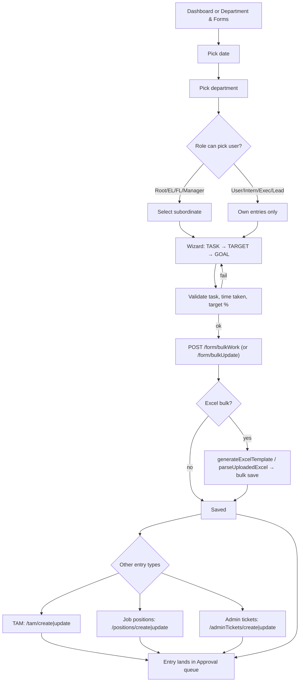
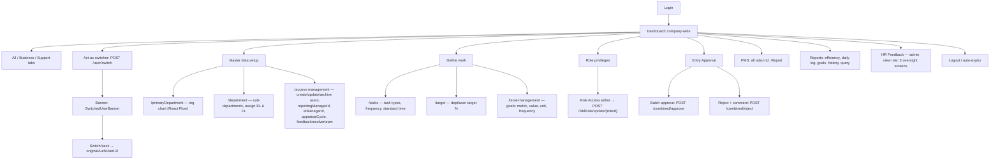
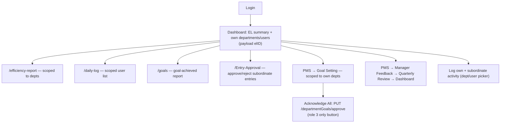
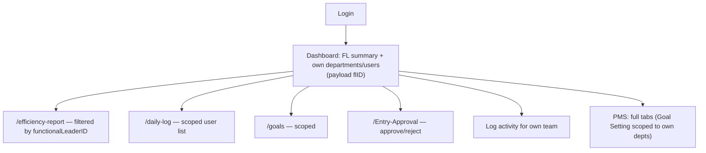
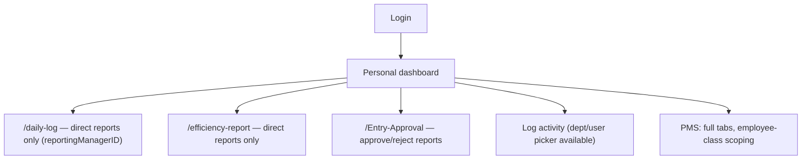
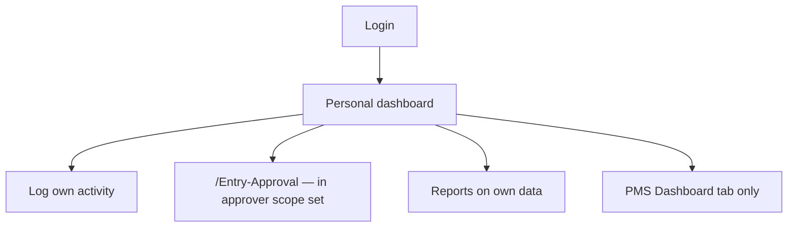
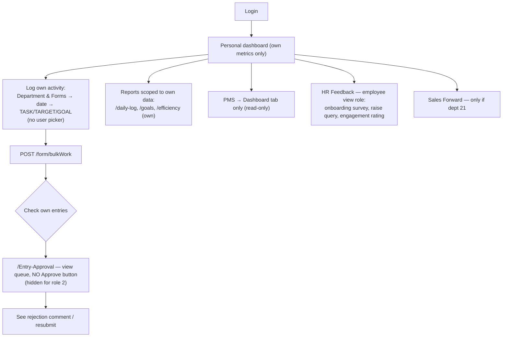
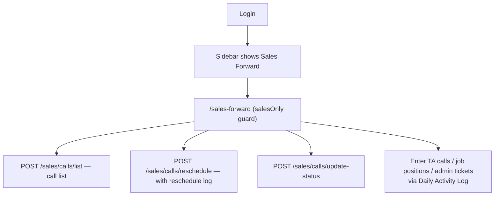
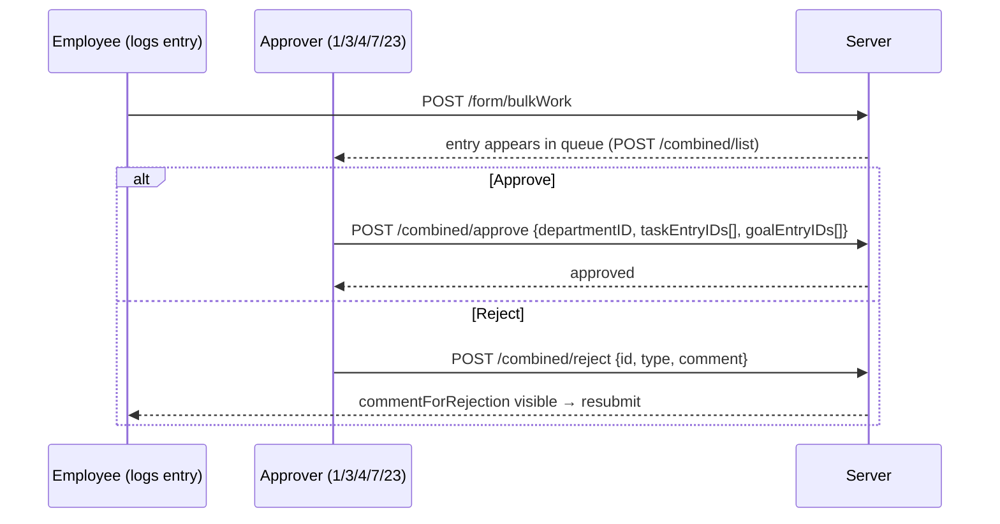
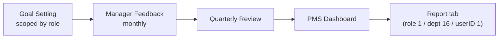

# Taskly — User Types & Use Flows

> Taskly (Utilization) is Tapmind's internal HR/workforce application for daily work logging,
> utilization & efficiency reporting, approval workflows, PMS, and HR feedback modules.
>
> Sources: `src/App.tsx`, `src/components/protectedRoute.tsx`, `src/components/sidebar.tsx`,
> `src/components/accessRole.tsx`, `src/pages/*`.

---

## Part 1 — User Types

Taskly has **no guest/signup/billing flow**. Users are created manually by an Admin and log in
with credentials. There are three orthogonal classification layers:

| Layer | What it controls | Source |
|---|---|---|
| **1. Primary role** (`userRole`, numeric) | Core identity, route guards, dashboard scope | JWT / `localStorage.authUserLD` |
| **2. Department pseudo-role** (`departmentID`) | Route guards (Sales/HR/Tech), sidebar filters | user record |
| **3. Module privileges** (`rolePrivileges`) | Per-module CRUD tiers, sidebar & tab visibility | `GET /AMRole/{roleId}` → `localStorage.roles` |

---

### 1.1 Primary Roles

| ID | Role | Category | One-line summary |
|---:|---|---|---|
| 1 | **Root User (Admin)** | System | Full control: all modules `root`, can approve, switch users, manage everything |
| 3 | **EL — Executive Leader** | Leadership | Sees own departments + users; acknowledges goals |
| 4 | **FL — Functional Leader** *(a.k.a. Reporting Manager)* | Leadership | Sees own departments + users; scoped to `functionalLeaderID` |
| 7 | **Manager** | Leadership (scoped) | Sees only direct reports (`reportingManagerID`) |
| 23 | **Lead** | Leadership (scoped) | Same treatment as standard employee in most modules |
| 2 | **User** | Employee | Standard employee: personal dashboard, own entries, read-only PMS |
| 6 | **Executive** | Employee | Same as User |
| 5 | **Intern** | Employee | Same as User |
| — | *optional `secondaryRoleID`* | — | A user may carry a second role from the list above |
| — | *`feedbackresolverteam`* | HR module | `HR` or `L_D` — selects the HR-module view role |

Reference: `src/pages/access-management.tsx:250-258`, `src/pages/accessRole.tsx:127-142`.

#### Capability matrix

| Capability | Root (1) | EL (3) | FL (4) | Manager (7) | Lead (23) | User (2) / Exec (6) / Intern (5) |
|---|:---:|:---:|:---:|:---:|:---:|:---:|
| Personal dashboard | ✅ | ✅ | ✅ | ✅ | ✅ | ✅ |
| Company-wide dashboard | ✅ | ❌ | ❌ | ❌ | ❌ | ❌ |
| Log own daily activity | ✅ | ✅ | ✅ | ✅ | ✅ | ✅ |
| Log for subordinates (dept/user picker) | ✅ | ✅ | ✅ | ✅ | ❌ | ❌ |
| **Approve / reject entries** | ✅ | ✅ | ✅ | ✅ | ✅ | ❌ |
| Acknowledge goals (`PUT /departmentGoals/approve`) | ❌ | ✅ | ❌ | ❌ | ❌ | ❌ |
| Efficiency / Daily-log reports (scoped) | ✅ all | ✅ depts | ✅ depts | ✅ reports | ✅ own | ✅ own |
| PMS — Goal Setting / Feedback / Quarterly | ✅ | ✅ | ✅ | ✅ | ✅ | ❌ (Dashboard tab only) |
| PMS — Report tab | ✅ | ❌ | ❌ | ❌ | ❌ | ❌ (also dept 16, `userID===1`) |
| Admin group (users, depts, tasks, targets, goals) | ✅ | ❌ | ❌ | ❌ | ❌ | ❌ |
| Access Management + Role Access editor | ✅ | ❌ | ❌ | ❌ | ❌ | ❌ |
| Goal Management screen | ✅ | ❌ | ❌ | ❌ | ❌ | ❌ (also Tech dept 24) |
| Sales Forward screen | ✅ | ✅ | ✅ | ✅ | ✅ | ✅ only if dept 21 |
| HR Feedback (all 3 modules) | ✅ | ✅ | ✅ | ✅ | ✅ | ✅ |
| Act-as / switch user | ✅ (+ userID 144) | ❌ | ❌ | ❌ | ❌ | ❌ |

#### Route guards (`src/components/protectedRoute.tsx:13-44`)

| Guard | Condition | Routes |
|---|---|---|
| `adminOnly` | `userRole !== 1` → redirect `/dashboard` | `/department`, `/primaryDepartment`, `/tasks`, `/target`, `/access-management`, `/User-History`, `/Query-Report` |
| `salesOnly` | `departmentID !== 21` | `/sales-forward` |
| `adminOrTech` | `userRole === 1` **or** `departmentID === 24` | `/Goal-management` |
| `HrOnly` / `TechOnly` | dept 22 / 24 | *defined but currently unused* |
| authenticated | no `authUserLD` → redirect `/` | all other protected routes |

---

### 1.2 Department Pseudo-Roles

| Dept ID | Name | Effect |
|---:|---|---|
| 21 | Sales | Unlocks **Sales Forward** sidebar item + route |
| 22 | HR | HR-module scope (guard defined, unused) |
| 24 | Tech | Unlocks **Goal Management** route; gets **WeeklyPulse** UI in activity log |
| 16 | "Report" dept | Unlocks PMS **Report** tab |

---

### 1.3 Module Privileges (`rolePrivileges`)

Modules: `dashboard`, `reports{perf, mydata, goals, entryApproval, userHistory, queryReport}`,
`dataentry`, `salesfwd`, `admin{accessmgmt, deptmgmt, taskmgmt, targetmgmt, goalmgmt}`,
`pms`, `hrfeedback`.

| Tier | Actions |
|---|---|
| `none` | — |
| `basic` | read |
| `createOnly` | read, create |
| `advanced` | read, create, update |
| `root` | read, create, update, delete |
| `custom` | any subset (per-action toggles) |

**Defaults** (`src/pages/accessRole.tsx:63-119`):

| Role | Notable defaults |
|---|---|
| User (2) | most `basic`; `entryApproval: advanced`; `salesfwd`/`admin`/`hrfeedback: none` |
| FL (4) / EL (3) | most `advanced`; `admin: none`; `pms: root` |
| Root (1) | **`root` on every module** |

Privileges drive **sidebar visibility** (`sidebar.tsx:101-128`) and **PMS tab visibility**
(`pms.tsx:16-24`).

---

### 1.4 HR-Module View Roles (sub-system)

Separate role picker inside `/hr-feedback` (`TasklyHRModules.jsx:240-256`):

| View role | Condition | Sees |
|---|---|---|
| **admin** | `userRole === 1` | 3 admin oversight screens + org-wide metrics |
| **hr / L&D** | `feedbackresolverteam === "HR"` / `"L_D"` | Rollout, resolver queue, scores |
| **employee** | everyone else | Own surveys, raise queries, engagement rating |

Tabs: `01 Onboarding Experience`, `02 Query & HR Support`, `03 Employee Engagement`.

---

## Part 2 — Use Flows

### 2.0 Universal flows (every user type)

#### A. Login & session

```mermaid
flowchart TD
    A[/"Open app: /""] --> B[Enter username + password]
    B --> C["POST /authenticate"]
    C -->|401| B
    C -->|200| D["Store response → localStorage.authUserLD"]
    D --> E["GET /AMRole/{roleId} → localStorage.roles"]
    E --> F["Web Push: VAPID → SW register → POST /hrFeedback/push/subscribe"]
    F --> G[Redirect /dashboard]
    G --> H{ProtectedRoute}
    H -->|no authUserLD| A
    H -->|ok| I[Layout: sidebar + topbar]
    I --> J{JWT exp timer}
    J -->|expired| K["Auto-logout: remove authUserLD → /"]
```

- Login: `src/pages/index.tsx:36-85`
- Guard: `src/components/protectedRoute.tsx:14-17`
- Expiry auto-logout: `src/components/topbar.tsx:83-104`
- Forgot password: `POST /forgotPassword` → email link → `/passwordHandler?token=…` → `POST /resetPassword` (`src/pages/forgotPassword.tsx:60-90`)
- Logout: `/logout` clears storage (`src/pages/logout.tsx:5-20`)

#### B. Daily core loop (all roles)



- Screen: `/activity-log` and `/department-forms` → `DailyActivityLog`
  (`src/pages/DailyActivityLog.tsx`, wizard step `entryStep`, admin starts at GOAL `:268-273`)
- Save: `POST /form/bulkWork` / `POST /form/bulkUpdate` (`:1255-1256`)
- Excel: `src/lib/excelUtils.ts:602,645`
- Tech dept 24 → **WeeklyPulse** weekly view instead (`DailyActivityLog.tsx:1952`)

#### C. Sidebar navigation (what each role actually sees)

```mermaid
flowchart LR
    subgraph Always
        D[Dashboard] --> DG[/dashboard]
        DF[Department & Forms] --> DFG[/department-forms]
        P[PMS] --> PG[/pms]
        HR[HR Feedback] --> HRG[/hr-feedback]
    end
    subgraph Reports[Reports ▾]
        R1[Performance Insights /efficiency-report]
        R2[User Data /daily-log]
        R3[Goals Achieved /goals]
        R4[Entry Approval /entry-approval]
        R5[User History /user-history]
        R6[Query Report /query-report]
    end
    subgraph Admin[Admin ▾ — role 1 only]
        A1[Access Management]
        A2[Department Management]
        A3[Sub Department Management]
        A4[Task Management]
        A5[Target Management]
        A6[Goal Management — role 1 or dept 24]
    end
    SF[Sales Forward — dept 21] --> SFG[/sales-forward]
```

Filtering logic: `src/components/sidebar.tsx:101-128, 262-285`.

---

### 2.1 Root User (Admin) — roleID 1



**Admin happy path (day 1 → run):**

1. Log in → company-wide Dashboard (All/Business/Support tabs).
2. Build org: Primary Departments → Sub-Departments (assign EL/FL) → Users
   (reporting manager, EL, appraisal cycle, HR resolver team).
3. Define work catalogue: Tasks → Targets → Goals.
4. Tune access: Role Access editor per module tier.
5. Daily: review Dashboard → run Entry Approval batches → export Excel.
6. Run PMS cycle: Goal Setting → Manager Feedback → Quarterly Review → Report.
7. Operate HR Feedback: rollout surveys, monitor admin health.
8. Optional: act as another user for support; switch back.

Key files: `src/pages/dashboard.tsx:499,1076,1537-1541`, `src/pages/access-management.tsx`,
`src/pages/TaskManagement.tsx`, `src/pages/EntryApproval.tsx:1045,1089`,
`src/components/userSwitch.tsx:35-103`.

---

### 2.2 Executive Leader (EL) — roleID 3



Distinctive behaviours:
- Dashboard payload includes `elID` (`src/pages/dashboard.tsx:478, 521-551`).
- **Only EL** sees the "Acknowledge All" goal button
  (`src/components/goalSetting.tsx:369-377`, API `:198`).
- PMS privileges default to `root` (`src/pages/accessRole.tsx`).

---

### 2.3 Functional Leader (FL) / Reporting Manager — roleID 4



Scope key: `functionalLeaderID` (`src/pages/dailyLogs.tsx:378-385`,
`src/pages/efficiency.tsx:353-359`, `src/components/goalSetting.tsx:328-334`).
No Acknowledge-All button (EL-only). No Admin group.

---

### 2.4 Manager — roleID 7



Scope key: `reportingManagerID` (`src/pages/dailyLogs.tsx:369-376`,
`src/pages/efficiency.tsx:364-371`).

---

### 2.5 Lead — roleID 23

Treated as a leadership-labelled employee: same PMS read-only treatment as User
(`src/pages/pms.tsx:30`), grouped with employees on the dashboard
(`dashboard.tsx:1082`), no dept filter on forms (`forms.tsx:285`), but **does** appear in the
approval `isELORUSER` scope set (`EntryApproval.tsx:193`).



---

### 2.6 Standard Employee — User (2) / Executive (6) / Intern (5)



Key restrictions:
- Approve button hidden: `src/pages/EntryApproval.tsx:1045, 759`.
- No dept/user filter on forms: `src/pages/forms.tsx:282-286`.
- PMS read-only: `src/pages/pms.tsx:26-43`.
- Default PMS entry step differs: admin starts at GOAL, employees at TASK
  (`src/pages/DailyActivityLog.tsx:268-273`).

---

### 2.7 HR-Module Roles (inside `/hr-feedback`)

```mermaid
flowchart TD
    L[Login → /hr-feedback] --> SEL{Role selector visible?}
    SEL -->|multiple roles| PICK[Choose view role]
    SEL -->|single| SUB[Default role]

    subgraph Employee
        E1[01 Onboarding: fill survey<br/>7× 1-10 + text → pending → submitted]
        E2[02 Query & HR Support: raise query, follow thread]
        E3[03 Employee Engagement: rate, respond]
    end
    subgraph HRT[HR / L&amp;D]
        H1[01 Onboarding: send survey (joiner + due date), scores]
        H2[02 Resolver queue: resolve queries]
        H3[03 Rollout engagement survey, track scores]
    end
    subgraph ADM[Admin]
        A1[01 Onboarding admin health]
        A2[Org-wide metrics]
        A3[Read-only oversight]
    end

    PICK --> Employee
    PICK --> HRT
    PICK --> ADM
    E1 -.push/email.-> H1
    H3 -.push/email.-> E3
```

- Entry point: `src/pages/hrFeedback.tsx` → `TasklyHRModules.jsx:227-311`.
- Notifications: Web Push (`src/lib/pushClient.ts`) + in-app bell polling
  `localStorage.hrModuleNotifications` every 2 s (`topbar.tsx:57-175`).
- Survey statuses: `pending → submitted`, or `no_response` past due
  (`taskly-hr/README.md:80`).
- Backend spec: `HR_MODULES_BACKEND.md`.

---

### 2.8 Sales team flow (department 21)



Ref: `docs/frontend/11-sales-forward.md`.

---

## Part 3 — Cross-cutting flows

### Approval workflow (roles 1, 3, 4, 7, 23)



Goal acknowledgement (separate, EL only): `PUT /departmentGoals/approve {goalIds, userId}`.

### PMS cycle



Tab visibility = `rolePrivileges.pms` + role class (`src/pages/pms.tsx:26-76`).

### Reporting & exports

| Screen | Audience | Key API |
|---|---|---|
| `/dashboard` | all (scope varies) | `POST /DashBoardAll`, `GET /calculateAll`, `GET /MissingData`, `POST /DashBoardAll/download/excel` |
| `/efficiency-report` | 1,3,4,7 + own | `list-efficiency-summary`, `download-efficiency-summary` |
| `/daily-log` | scoped | `userWorkDataList` |
| `/goals` | scoped | `userGoalData/list` |
| `/User-History` | admin | dept history + drill-down |
| `/Query-Report` | admin | filter builder |

---

## Appendix — Route ↔ Role quick reference

| Route | Guard / visible to |
|---|---|
| `/` , `/passwordHandler` , `/logout` | public |
| `/dashboard`, `/activity-log`, `/department-forms`, `/daily-log`, `/efficiency-report`, `/goals`, `/Entry-Approval`, `/pms`, `/hr-feedback` | any authenticated |
| `/sales-forward` | dept 21 |
| `/Goal-management` | role 1 or dept 24 |
| `/department`, `/primaryDepartment`, `/tasks`, `/target`, `/access-management`, `/User-History`, `/Query-Report` | role 1 only |
| *(unrouted)* `/reports` | legacy, not linked (`src/pages/reports.tsx`) |

---

### Known caveats

1. **Role 4 dual naming** — "FL / Functional Leader" vs "Reporting Manager"; role 7 also
   commented as Reporting Manager (`dailyLogs.tsx:369`).
2. **Sidebar href casing** — sidebar uses lowercase (`entry-approval`) vs route
   (`/Entry-Approval`); relies on React Router case-insensitive matching.
3. **Hardcoded IDs** — roles `1,2,3,4,5,6,7,23`; depts `16,21,22,24` are inline literals.
4. **Special-cases** — `userID === 144` gets the act-as switcher; `userID === 1` gets PMS Report.
5. **No invite/onboarding product flow** — provisioning is manual via Admin's Add User modal
   (password field currently commented out, `access-management.tsx:713-725`).
